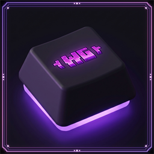

<p align="center">
  
</p>

<h1 align="center">WildeGate KeyBinds</h1>

<p align="center">
  Клиентский мод для Minecraft <b>1.21.11</b>: две назначаемые клавиши для активных способностей
  рас сервера <b>WildeGate</b> — по умолчанию <b>R</b> (способность №1) и <b>G</b> (способность №2).
</p>

<p align="center">
  <a href="https://github.com/bywanthh/wgkeybinds/releases/latest"></a>
  
  
  <a href="LICENSE"></a>
</p>

<p align="center">
  
  
  
</p>

---

## Что это

Мод добавляет в Minecraft две клавиши, привязанные к активным способностям вашей расы
на сервере WildeGate. Нажали **R** — сработала способность №1, нажали **G** — способность №2.
Клавиши переназначаются как обычно, в настройках управления.

В «Настройки → Управление → Назначение клавиш» появляется категория
**WildeGate: Способности** с двумя пунктами: «Способность №1» и «Способность №2».

## Скачать

| Файл | Для чего | Что ещё нужно |
|---|---|---|
| [`wgkeybinds-fabric-1.0.jar`](https://github.com/bywanthh/wgkeybinds/releases/latest) | Fabric | **Fabric API** |
| [`wgkeybinds-neoforge-1.0.jar`](https://github.com/bywanthh/wgkeybinds/releases/latest) | NeoForge 21.11.48+ | ничего дополнительно |

Обе сборки лежат на странице **[Releases](https://github.com/bywanthh/wgkeybinds/releases/latest)**
и в папке [`release`](release) этого репозитория. Хеши SHA-256 — в
[`release/SHA256SUMS.txt`](release/SHA256SUMS.txt).

## Установка

1. Поставьте загрузчик для Minecraft **1.21.11**: [Fabric Loader](https://fabricmc.net/use/installer/)
   или [NeoForge 21.11.48+](https://neoforged.net/).
2. Положите нужный JAR в папку `.minecraft/mods/`.
   Для Fabric-версии **обязателен [Fabric API](https://modrinth.com/mod/fabric-api)** — без него мод не загрузится.
3. Запустите игру и проверьте: настройки → управление → «WildeGate: Способности».

Сервер устанавливать **не нужно и не нужно просить об этом админов**: мод целиком клиентский,
серверная часть на WildeGate уже стоит.

## Как это работает

```
нажатие R / G ──► пакет wildegate:keys (1 = №1, 2 = №2) ──► сервер WildeGate ──► срабатывает способность вашей расы
вход в игру  ──► пакет wildegate:keys (0 = «мод установлен») ──► сервер сразу отключает старые жесты
```

* Мод отправляет серверу **одно короткое число** — ID способности. Ничего больше.
* Хендшейк при входе нужен, чтобы на сервере у вас сразу отключилась старая механика жестов
  (двойное нажатие F) — тогда **F остаётся обычной сменой рук**, а способности висят только на биндах.
* Если у игрока мода нет, он может вызвать способности жестами: **F ×2** — способность №1,
  **Shift + F ×2** — способность №2. Обе механики сходятся в один и тот же код на сервере,
  поэтому случайных двойных срабатываний нет.
* На **любом другом сервере** мод не делает ничего: пакет читает только серверная часть WildeGate.

## Мод ничего лишнего не делает

Это проверяется по исходникам за пару минут — весь мод состоит из **трёх классов**:

| Файл | Что делает |
|---|---|
| [`WildeGateKeysClient.java`](fabric/src/client/java/ru/wildegate/keys/WildeGateKeysClient.java) · [NeoForge](neoforge/src/main/java/ru/wildegate/keys/WildeGateKeysClient.java) | регистрирует две клавиши, по нажатию отправляет ID способности, при входе отправляет хендшейк |
| [`AbilityPayload.java`](fabric/src/main/java/ru/wildegate/keys/AbilityPayload.java) · [NeoForge](neoforge/src/main/java/ru/wildegate/keys/AbilityPayload.java) | описание пакета: одно число (VarInt) |
| [`WildeGateKeys.java`](fabric/src/main/java/ru/wildegate/keys/WildeGateKeys.java) · [NeoForge](neoforge/src/main/java/ru/wildegate/keys/WildeGateKeys.java) | три константы: id мода, имя канала, имя внутренней команды |

Чего в моде **нет**:

* телеметрии и аналитики — мод не ходит в интернет и не открывает своих соединений;
* чтения чата, инвентаря, координат, файлов на диске;
* обфускации и миксинов в ванильные классы;
* собственных предметов, блоков и правки интерфейса.

В JAR лежат только эти три класса, метаданные, иконка и два файла локализации — это видно
и по размеру (~100 КБ Fabric, ~200 КБ NeoForge).

## Проверка подлинности

**1. Сверьте хеш скачанного файла** с [`release/SHA256SUMS.txt`](release/SHA256SUMS.txt):

```powershell
Get-FileHash .\wgkeybinds-fabric-1.0.jar -Algorithm SHA256   # Windows
```

```bash
sha256sum wgkeybinds-fabric-1.0.jar                          # Linux / macOS
```

**2. Или соберите сами** — в репозитории есть полные исходники и обёртка Gradle:

```bash
cd fabric        # или cd neoforge
gradlew.bat build        # Windows
./gradlew build          # Linux / macOS
```

Требования к сборке: **JDK 25** для запуска Gradle (wrapper 9.8.1 уже в комплекте, Loom 1.19.1
требует именно 25) — сами моды компилируются под **Java 21** и требуют Minecraft 1.21.11;
зависимости Gradle скачает сам. Результат — `build/libs/wgkeybinds-*.jar` с тем же набором
классов, что и в релизе. Сверить побайтово можно так: распакуйте оба JAR (это обычный ZIP)
и сравните `ru/wildegate/keys/*.class` и `fabric.mod.json` / `META-INF/neoforge.mods.toml`.

## Требования

* Minecraft **1.21.11**
* Fabric: Loader **0.19.5+** и **Fabric API** · NeoForge: **21.11.48+**
* Java **21+**

Другие версии Minecraft не поддерживаются: в 1.21.11 изменились и внутренние маппинги, и сетевой API.

## Структура репозитория

```
fabric/     исходники Fabric-мода (Gradle-проект со своим wrapper)
neoforge/   исходники NeoForge-мода (Gradle-проект со своим wrapper)
release/    готовые JAR и SHA256SUMS.txt — то же, что в Releases
```

В репозитории **только клиентские моды**. Серверная часть WildeGate (система рас на Skript
и плагин-мост канала `wildegate:keys`) сюда не входит и распространяется отдельно.

## FAQ

**Это безопасно? Боюсь ставить мод с GitHub.**
Логично — GitHub полон чего угодно. Здесь можно не верить на слово: код открыт (три класса),
хеши сборок опубликованы, а собрать JAR самому — две команды (`gradlew.bat build`). Если сборка
из исходников даёт тот же результат, что в релизе, значит в JAR нет ничего скрытого.
Сравнить можно и по хешам частей: `certutil -hashfile <файл> SHA256` в распакованном JAR.

**Будет ли работать на другом сервере?**
Мод загрузится и клавиши появятся, но нажимать их будет бессмысленно: способности считает
серверная часть WildeGate. Ничего не сломается, просто ничего не произойдёт.

**Нужен ли мод админам на сервере?**
Нет. Мод клиентский, на сервер его не ставят.

**Что делать, если у меня уже стоят шейдеры / оптимизации (Iris, Sodium, OptiFine)?**
Мод не трогает рендер, инвентарь и интерфейс, поэтому конфликтов не ожидается. Если что-то
не так — проверьте, что у вас Fabric-версия с Fabric API (для Fabric) или NeoForge 21.11.48+.

**Почему в настройках нет категории «WildeGate: Способности»?**
Скорее всего мод не загрузился: проверьте, что JAR лежит в папке `mods`, что это версия
для вашего загрузчика и для Minecraft 1.21.11, и что установлен Fabric API (для Fabric).

**F у меня больше не работает как смена рук / наоборот ничего не происходит.**
С модом старые жесты на сервере отключаются автоматически — F остаётся обычной сменой рук,
а способности вызываются биндами. Если у вас мод не стоит, работают жесты: F ×2 и Shift + F ×2.

**Можно ли переназначить клавиши?**
Да, любые: настройки → управление → назначение клавиш → «WildeGate: Способности».

## Лицензия

[MIT](LICENSE) — можно свободно читать, собирать, изменять и распространять,
сохраняя указание авторства (**#bywanthh**).

---

## English (short)

**WildeGate KeyBinds** — a small client-side Minecraft **1.21.11** mod that adds two rebindable
keys (default **R** / **G**) which send ability IDs `1` / `2` to the server over the
`wildegate:keys` plugin channel. It is made for the **WildeGate** server; anywhere else it does nothing.

* **Client only** — nothing to install on the server.
* **No telemetry, no analytics, no network requests of its own**: the mod only sends one VarInt
  (`0` = handshake on join, `1` / `2` = ability) to the server you are already playing on.
* **Three classes, no obfuscation, no mixins** — see `fabric/` and `neoforge/`.
* Download from [Releases](https://github.com/bywanthh/wgkeybinds/releases/latest);
  SHA-256 hashes in [`release/SHA256SUMS.txt`](release/SHA256SUMS.txt).
* Build it yourself: `cd fabric && gradlew.bat build` (JDK 25 for Gradle, the mod targets Java 21).
* License: **MIT**.

## Связь с автором

Discord: [https://discord.gg/EYqdKVCFjX](https://discord.gg/EYqdKVCFjX) · Telegram: [https://t.me/bywanthh](https://t.me/bywanthh)
